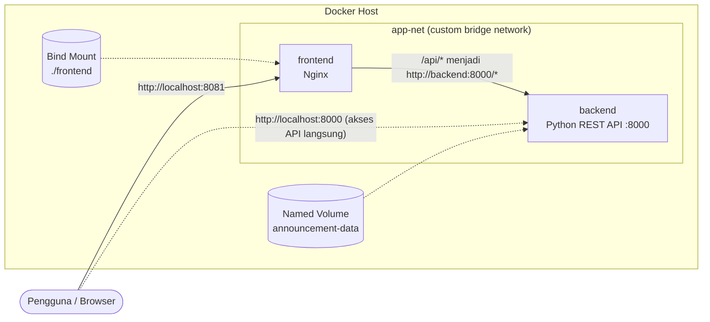
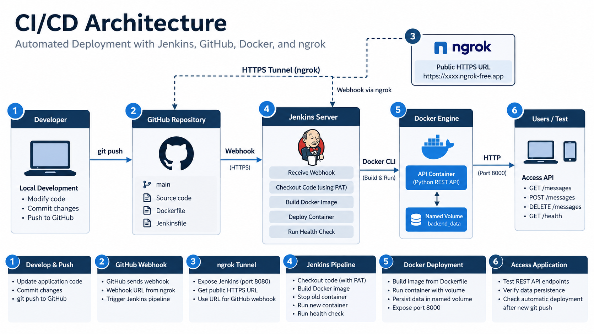

# Papan Pengumuman Kampus (Campus Announcement Board)

**Cloud-Native Fullstack Application & Automated CI/CD Pipeline**
Ujian Chunin (UTS) - Mata Kuliah Cloud Computing, Telkom University

## Anggota Kelompok

| No | Nama | NIM |
|----|------|-----|
| 1 | _isi nama anggota 1_ | _isi NIM_ |
| 2 | _isi nama anggota 2_ | _isi NIM_ |
| 3 | _isi nama anggota 3_ | _isi NIM_ |
| 4 | _(opsional)_ | _(opsional)_ |

**Studi kasus yang dipilih:** #2 - Papan Pengumuman Kampus (Campus Announcement Board)
Portal informasi pengumuman perkuliahan dan kegiatan Ormawa.

---

## 1. Ringkasan

Aplikasi web fullstack sederhana untuk mengelola pengumuman kampus. Seluruh stack berjalan di Docker dan otomatis ter-deploy lewat Jenkins setiap kali ada `git push` ke branch `main`.

| Komponen | Teknologi | Keterangan |
|----------|-----------|------------|
| Backend | Python (standard library, tanpa framework) | REST API JSON, port 8000 |
| Frontend | HTML + Vanilla JS (`fetch()`) di Nginx | Port 8081, **Bind Mount** |
| Penyimpanan | File `announcements.json` | **Named Volume** `announcement-data` |
| Jaringan | Custom bridge network `app-net` | Frontend dan backend terhubung lewat nama service |
| Orkestrasi | Docker Compose | `docker-compose.yml` |
| CI/CD | Jenkins + GitHub Webhook (via ngrok) | `Jenkinsfile` dengan 5 stage |

## 2. Diagram Arsitektur

### 2.1 Arsitektur Docker



Poin penting:

- **Named Volume `announcement-data`** di-mount ke `/var/lib/backend_data` pada backend. Data bertahan walau container dihapus.
- **Bind Mount `./frontend`** di-mount ke `/usr/share/nginx/html` pada Nginx. Mengubah `index.html` langsung terlihat tanpa rebuild image.
- Browser hanya memanggil `/api/...` ke Nginx. Nginx meneruskannya ke `http://backend:8000` memakai **DNS Docker (nama service)** di dalam `app-net`.

### 2.2 Arsitektur CI/CD



Alur: **Developer `git push`, GitHub mengirim webhook lewat tunnel ngrok, Jenkins menjalankan pipeline (Checkout, Syntax Check, Build Image, Automated Deployment, Health Check), Docker Engine menjalankan container, lalu pengguna mengakses aplikasi.**

## 3. Struktur Repositori

```
campus-announcement-board/
├── backend/
│   ├── app.py              # REST API Python
│   ├── Dockerfile
│   └── .dockerignore
├── frontend/
│   └── index.html          # UI HTML + Vanilla JS
├── nginx/
│   └── default.conf        # Konfigurasi Nginx (reverse proxy /api -> backend)
├── docs/
│   └── ci-cd-architecture.png
├── docker-compose.yml
├── Jenkinsfile
├── .gitignore
└── README.md
```

## 4. Dokumentasi API

Base URL: `http://localhost:8000` (langsung) atau `http://localhost:8081/api` (lewat Nginx).

| Method | Endpoint | Fungsi | Respons sukses |
|--------|----------|--------|----------------|
| GET | `/announcements` | Daftar semua pengumuman | `200` + array JSON |
| POST | `/announcements` | Tambah pengumuman | `201` + objek yang dibuat |
| DELETE | `/announcements?index=X` | Hapus pengumuman pada posisi X (mulai 0) | `200` + objek yang dihapus |
| GET | `/health` | Pengecekan kesehatan layanan | `200` `{"status":"ok"}` |

Body `POST /announcements`:

```json
{
  "title": "Jadwal UTS Cloud Computing",
  "content": "UTS dilaksanakan Senin pukul 08.00 di Lab Jaringan.",
  "category": "Akademik",
  "author": "BAAK"
}
```

- `title` dan `content` **wajib**. `author` (default `Admin`) dan `category` (default `Umum`) opsional.
- Kategori yang diizinkan: `Umum`, `Akademik`, `Ormawa`, `Kegiatan`, `Beasiswa`.

Penanganan error:

| Kondisi | Status |
|---------|--------|
| Body bukan JSON, field wajib kosong, kategori tidak valid, `index` kosong atau bukan angka | `400` |
| Endpoint tidak ada, atau `index` di luar jangkauan | `404` |
| Method tidak didukung pada endpoint yang ada (PUT/PATCH) | `405` |
| Body lebih dari 16 KB | `413` |

Contoh `curl`:

```bash
curl http://localhost:8000/announcements

curl -X POST http://localhost:8000/announcements \
  -H "Content-Type: application/json" \
  -d '{"title":"Libur Nasional","content":"Kampus libur hari Senin.","category":"Umum"}'

curl -X DELETE "http://localhost:8000/announcements?index=0"
```

## 5. Instalasi Lokal

Prasyarat: Docker Engine dan Docker Compose v2 (`docker compose version`), serta Git.

```bash
git clone https://github.com/<username>/<nama-repo>.git
cd <nama-repo>

docker compose up -d --build
docker compose ps
```

Akses:

- Frontend: http://localhost:8081
- API: http://localhost:8000/announcements
- Health: http://localhost:8000/health

Perintah berguna:

```bash
docker compose logs -f backend      # lihat log
docker compose down                 # hentikan stack (data AMAN)
docker volume ls                    # pastikan announcement-data ada
docker network ls                   # pastikan campus-announcement_app-net ada
```

> **Jangan** menjalankan `docker compose down -v` kecuali memang ingin menghapus seluruh data, karena `-v` ikut menghapus Named Volume.

Menjalankan backend tanpa Docker (opsional, untuk debugging):

```bash
DATA_DIR=./data python3 backend/app.py
```

## 6. Setup Jenkins + GitHub Webhook

### 6.1 Prasyarat server Jenkins

Jenkins diasumsikan terpasang langsung di mesin/VM (bukan di dalam container) bersama Docker.

```bash
# Izinkan user jenkins memakai Docker, lalu restart Jenkins
sudo usermod -aG docker jenkins
sudo systemctl restart jenkins

# Pastikan tool berikut tersedia
python3 --version
curl --version
docker compose version
```

Plugin Jenkins yang dibutuhkan: **Git**, **GitHub**, **Pipeline** (biasanya sudah ada pada "Install suggested plugins").

> Bila Jenkins dijalankan di dalam container, path Bind Mount (`./frontend`) dan `localhost` pada Health Check bisa tidak cocok. Gunakan Jenkins yang terpasang di host.

### 6.2 Membuat GitHub Personal Access Token (PAT)

1. Login GitHub, klik foto profil, **Settings**.
2. Menu kiri paling bawah, **Developer settings**.
3. **Personal access tokens**, **Tokens (classic)**, **Generate new token (classic)**.
4. Note: `Jenkins CI/CD UTS Token`, Expiration: 30 atau 90 hari.
5. Centang `repo` dan `admin:repo_hook`.
6. **Generate token**, lalu salin tokennya (`ghp_xxxx...`). Token hanya tampil sekali.

### 6.3 Menyimpan PAT di Jenkins

**Manage Jenkins, Credentials, System, Global credentials, Add Credentials**

| Field | Isi |
|-------|-----|
| Kind | Username with password |
| Username | username GitHub |
| Password | PAT (`ghp_xxxx...`) |
| ID | `github-pat` |

### 6.4 Membuat job pipeline

1. **New Item**, nama `campus-announcement-board`, pilih **Pipeline**, OK.
2. Bagian **Build Triggers**, centang **GitHub hook trigger for GITScm polling**.
3. Bagian **Pipeline**:
   - Definition: **Pipeline script from SCM**
   - SCM: **Git**
   - Repository URL: `https://github.com/<username>/<nama-repo>.git`
   - Credentials: `github-pat`
   - Branch Specifier: `*/main`
   - Script Path: `Jenkinsfile`
4. **Save**, lalu klik **Build Now** satu kali untuk memastikan pipeline hijau.

### 6.5 Membuka Jenkins ke internet dengan ngrok

GitHub tidak bisa menjangkau Jenkins di jaringan lokal, jadi dibuat tunnel HTTPS publik:

```bash
ngrok http 8080
```

Salin URL `https://xxxx.ngrok-free.app` dari output ngrok. URL ini **berubah setiap ngrok dijalankan ulang** (akun gratis), sehingga webhook harus diperbarui.

### 6.6 Memasang GitHub Webhook

Repo GitHub, **Settings, Webhooks, Add webhook**:

| Field | Isi |
|-------|-----|
| Payload URL | `https://xxxx.ngrok-free.app/github-webhook/` (garis miring di akhir wajib) |
| Content type | `application/json` |
| Events | Just the push event |
| Active | dicentang |

Setelah disimpan, tab **Recent Deliveries** harus menunjukkan centang hijau (respons 200).

## 7. Pipeline Jenkins (5 Stage)

| # | Stage | Yang dilakukan |
|---|-------|----------------|
| 1 | Checkout | `checkout scm` (menarik kode dari GitHub memakai PAT) |
| 2 | Syntax Check | `python3 -m py_compile backend/app.py` dan `docker compose config -q` |
| 3 | Build Image | `docker compose build backend` |
| 4 | Automated Deployment | `docker compose up -d --remove-orphans` (tanpa `-v`, volume aman) |
| 5 | Health Check | Retry `GET /health` ke backend, lalu cek `/api/health` lewat Nginx |

## 8. Skenario Demo (untuk video 5-8 menit)

### A. Demo UI dan API (sekitar 2 menit)
1. `docker compose ps` memperlihatkan 2 container berjalan.
2. Buka http://localhost:8081, tambah 2-3 pengumuman, lalu hapus satu.
3. Perlihatkan API: `curl http://localhost:8000/announcements`.
4. Perlihatkan error handling: `curl -i "http://localhost:8000/announcements?index=99"` (404) dan POST dengan body kosong (400).

### B. Data Immunity (sekitar 2 menit)
```bash
docker rm -f announcement-backend      # hancurkan container backend
curl http://localhost:8000/health      # gagal, container sudah tidak ada
docker compose up -d                   # buat ulang container
curl http://localhost:8000/announcements   # data MASIH ADA
```
Perlihatkan juga `docker volume inspect announcement-data`.

### C. Bind Mount (sekitar 30 detik)
Ubah teks judul di `frontend/index.html`, simpan, refresh browser. Perubahan langsung tampil tanpa rebuild.

### D. CI/CD otomatis (sekitar 2-3 menit)
1. Tampilkan Jenkins dan ngrok yang sedang berjalan, serta webhook GitHub.
2. Ubah sesuatu (misal teks di `index.html` atau pesan di `app.py`), lalu:
   ```bash
   git add .
   git commit -m "Update demo CI/CD"
   git push origin main
   ```
3. Perlihatkan Jenkins ter-trigger **otomatis** (tanpa Build Now) dan semua stage hijau.
4. Refresh aplikasi dan perlihatkan perubahan sudah ter-deploy.

## 9. Pemecahan Masalah

| Masalah | Penyebab / solusi |
|---------|-------------------|
| `permission denied` pada docker di Jenkins | User `jenkins` belum masuk grup `docker`; jalankan `usermod -aG docker jenkins` lalu restart Jenkins |
| Webhook GitHub merah (timeout / 404) | URL ngrok berubah atau tidak ada `/` di akhir `/github-webhook/` |
| Webhook sukses tapi Jenkins tidak jalan | Centang **GitHub hook trigger for GITScm polling** belum aktif, atau job belum pernah dijalankan sekali |
| Port 8080 bentrok | Jenkins memakai 8080; frontend sudah dipasang di 8081 |
| Data hilang setelah deploy | Ada `-v` pada `docker compose down`; hapus opsi tersebut |
| Stage Checkout gagal autentikasi | PAT kedaluwarsa atau scope `repo` belum dicentang |
